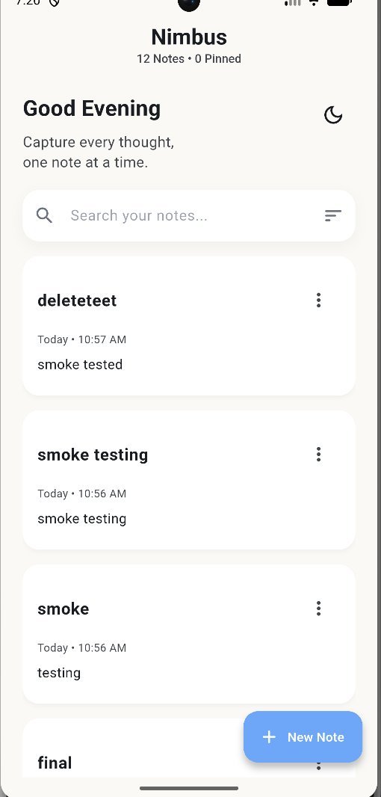
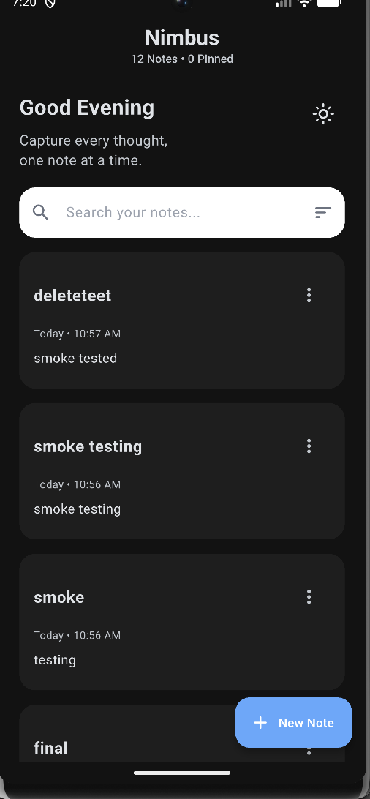
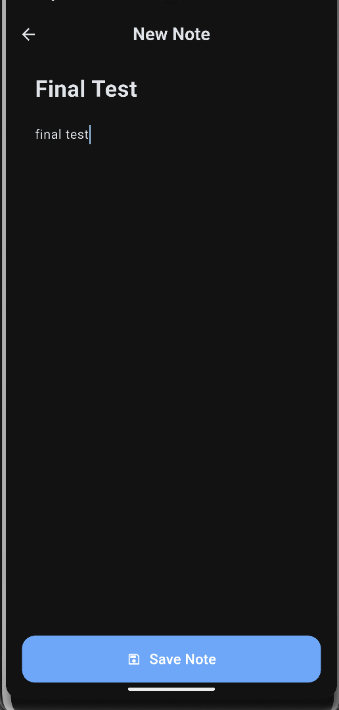
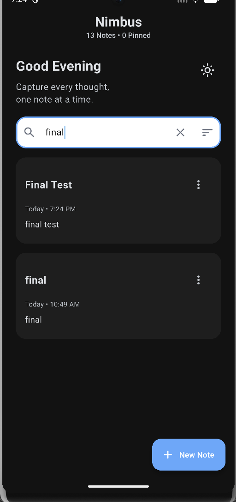
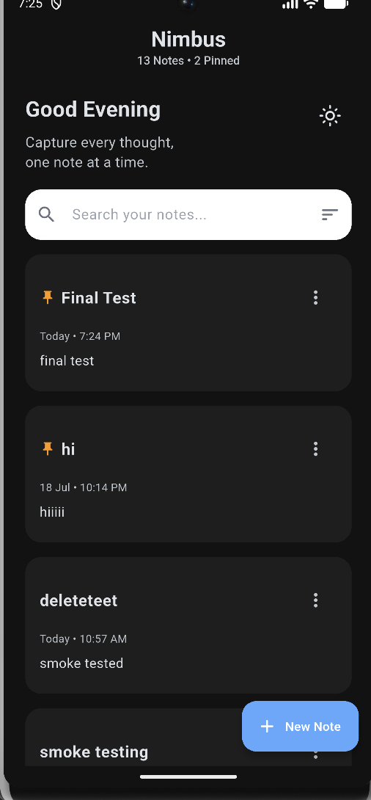
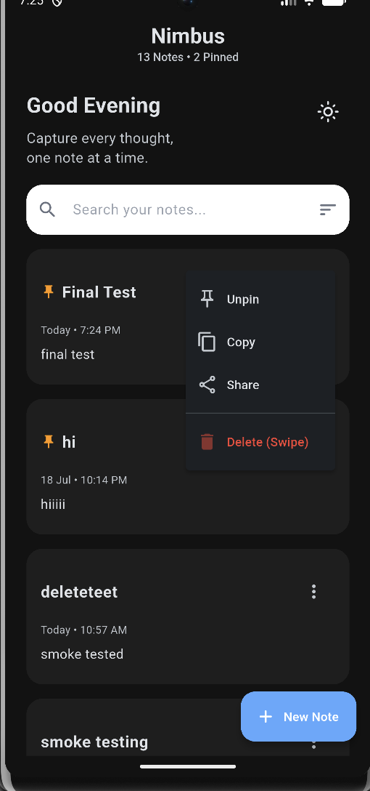

# Nimbus ☁️

**Nimbus** is a modern and simple notes application built with **Flutter** that allows users to create, edit, organize, search, and manage their notes with local data persistence.

## ✨ Features

* 🌙 **Dark / Light Mode** - Switch between light and dark themes.
* 🔍 **Search** - Search notes by title or content.
* 📌 **Pin / Unpin** - Keep important notes easily accessible.
* 🔃 **Sorting** - Sort notes using multiple sorting options.
* 📋 **Copy** - Copy note content to the clipboard.
* 📤 **Share** - Share notes using the device's sharing options.
* 🗑️ **Swipe-to-delete** - Delete notes with a swipe gesture.
* ⚠️ **Delete Confirmation** - Confirm before permanently deleting a note.
* ↩️ **Undo** - Restore a recently deleted note using the undo option.
* 🕒 **Last Edited Time** - View when a note was last updated.
* 🔝 **Updated Notes Move to the Top** - Recently updated notes are prioritized when using the newest-first sorting option.
* 📊 **Notes & Pinned Count** - View the total number of notes and pinned notes.
* 🏷️ **Automatic Title Generation** - If no title is entered, the first line of the note content is automatically used as the title.
* 💾 **Local Storage** - Notes are stored locally using Hive.
* 💡 **Persistent Theme Preference** - The selected theme is remembered when the app is reopened.
* 🔃 **Persistent Sorting Preference** - The selected sorting option is remembered between app sessions.
* 🎨 **UI Polish** - Clean and modern interface designed for a simple note-taking experience.
* 📱 **Custom App Icon** - Nimbus branding is used instead of the default Flutter icon.
* 🖼️ **Custom Splash Screen** - Nimbus branding is displayed while the app launches.

## 🛠️ Tech Stack

* **Flutter**
* **Dart**
* **Hive** - Local note storage
* **SharedPreferences** - Persistent user preferences
* **Share Plus** - Note sharing functionality

## 📱 App Overview

Nimbus provides a simple interface for managing personal notes. Users can create and edit notes, search through their saved content, pin important notes, sort their notes, copy or share note content, and delete notes using a swipe gesture.

The application uses local storage, allowing notes and their associated states to remain available between app sessions without requiring an internet connection or a remote database.

## 💾 Data Persistence

Nimbus uses **Hive** for storing notes locally on the device.

The following user data and preferences are persisted locally:

* Notes
* Note content
* Pinned status
* Theme preference
* Sorting preference

This allows the application to retain important user preferences and note data when the app is closed and reopened.

## 🚀 Getting Started

### Prerequisites

Make sure you have the following installed:

* Flutter SDK
* Dart SDK
* Android Studio or another Flutter-compatible IDE
* Android Emulator or a physical Android device

## 📦 Release

**Current Version:** `1.0.2`

**Build:** `2`

The Android release APK is available as:

`Nimbus-v1.0.2.apk`

## 📸 Screenshots

### Home Screen — Light Mode

### Home Screen — Dark Mode

### Create and Edit Notes

### Search

### Sorting

### Note Actions

## 🔮 Future Improvements

Possible future enhancements for Nimbus include:

* 🗑️ Trash Bin for deleted notes
* 📁 Note categories or folders
* ☁️ Cloud synchronization
* 🔐 User authentication
* ✏️ Rich text editing

## 📌 Project Details

**Made by - Natlie Pinto**

**Project Name:** Nimbus

**Platform:** Android

**Framework:** Flutter

**Version:** 1.0.2

## 📱 Download

Download the latest Android APK:

[Nimbus v1.0.2 APK] https://github.com/natlie05-del/Nimbus/releases/tag/v1.0.2
---

Made with Flutter 💙

